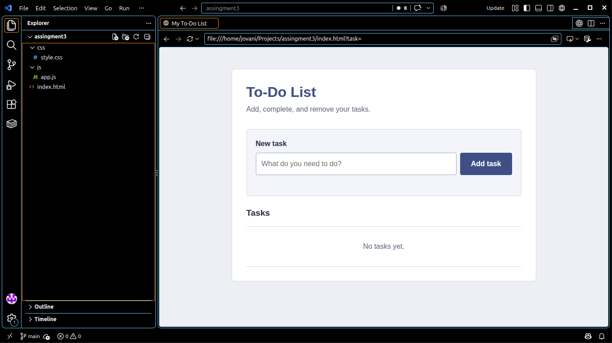
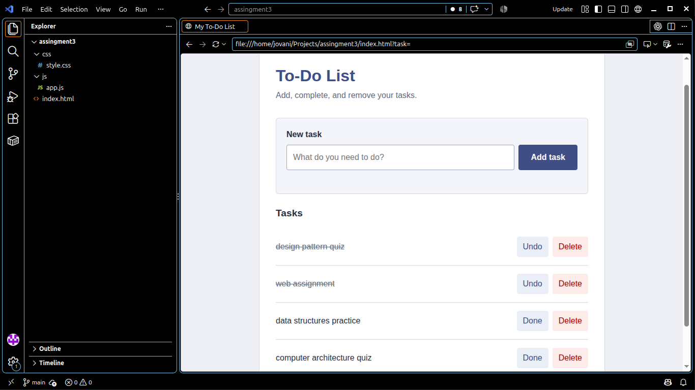

# To-Do List

## Features

- Add a task using the button or Enter.
- Mark tasks as done or undo their completion.
- Delete tasks.
- Keep tasks after refreshing the page using localStorage.
- Show an error for empty or spaces-only input.
- Adjust the layout for smaller screens.

## How to run

Open `index.html` in a browser. No installation is needed. You can also use the Live Server extension in VS Code.

Tasks are saved in the browser where you use the app, so they are not shared between browsers or devices.

## Files

- `index.html` — page structure
- `css/style.css` — styling and responsive layout
- `js/app.js` — task actions and localStorage
- `screenshots/` — empty and populated list screenshots

## Screenshots

### Empty list

### List with tasks

